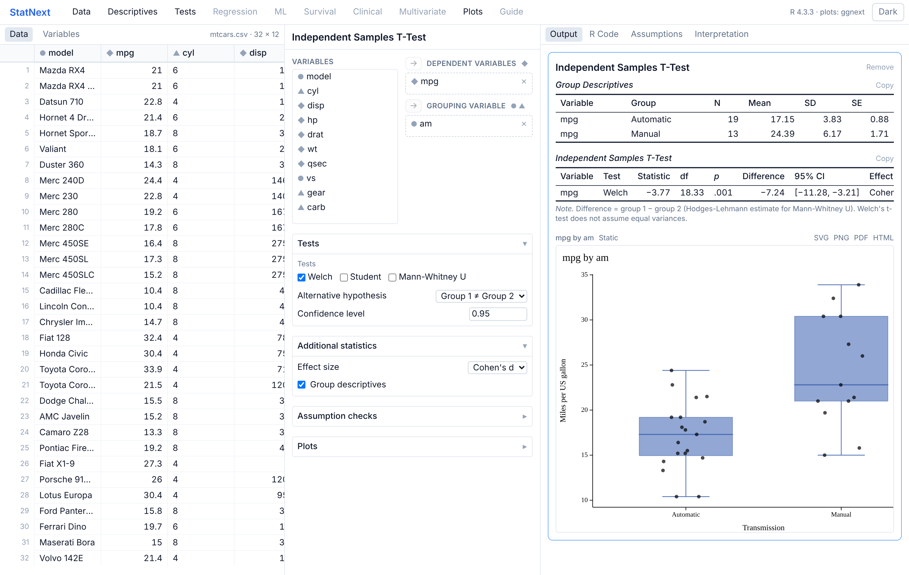
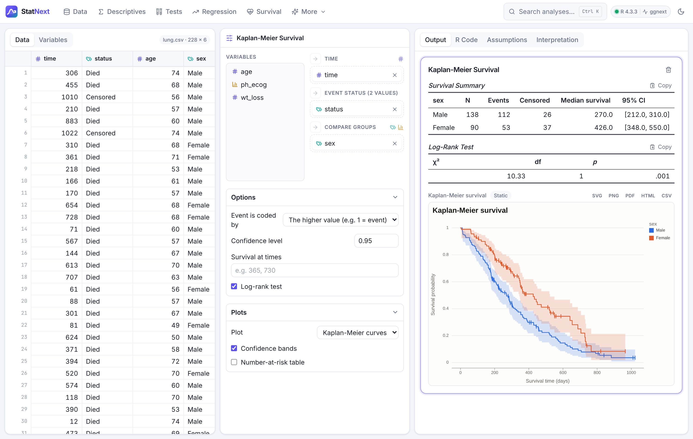

# StatNext

Point-and-click statistics desktop app. Every result is computed by a local R and comes with the exact R code that produced it.

- **Shell:** Tauri 2 (Rust) · React 18 + TypeScript + Tailwind
- **Engine:** local R ≥ 4.4 (`r-backend/`, package `statnextr`) over JSON-RPC on stdio
- **Plots:** ggnext (SVG + interactive HTML), ggplot2 fallback flagged in the UI
- **Platforms:** macOS first; Windows and Linux builds from the same tree



## What is in it (Phases 1–4)

| Area | Contents |
|---|---|
| Data | CSV/TSV, Excel, SPSS, Stata, SAS, Parquet; virtual grid; variable view (labels, measure, value labels, missing codes); compute, recode and filter with undo/redo |
| Descriptives | Descriptives, frequencies, normality; reliability: Cronbach's α, ICC, Cohen's kappa |
| T-tests, ANOVA | One-sample, paired, independent; one-way (Fisher, Welch, Kruskal-Wallis; Tukey, Games-Howell, Dunn), factorial, ANCOVA, repeated measures, mixed |
| Non-parametric | Wilcoxon signed-rank, sign test, Friedman |
| Frequencies | Chi-square / Fisher, goodness of fit, binomial, McNemar, Cochran's Q |
| Regression | Correlation (Pearson, Spearman, Kendall, partial); linear, logistic, ordinal, multinomial, Poisson / negative binomial; linear and generalized mixed models |
| Survival | Kaplan-Meier with log-rank test, Cox regression with proportional-hazards check |
| Multivariate | PCA, exploratory factor analysis (KMO, Bartlett, rotations), k-means and hierarchical clustering (silhouette) |
| Machine learning | Decision tree, random forest, gradient boosting, elastic net, SVM, naive Bayes, LDA; classification or regression, train/test split, confusion matrix, ROC/AUC, permutation importance, SHAP |
| Time series | Explore (decomposition, ACF/PACF, stationarity tests), ARIMA and ETS forecasting with hold-out accuracy |
| Clinical | Diagnostic accuracy (2×2, ROC with DeLong), meta-analysis (generic, binary, continuous; forest, funnel, Egger, trim-and-fill, leave-one-out, moderators), Table 1 and adverse-event tables |
| Bayesian | T-tests (one-sample, paired, independent), ANOVA (incl. repeated measures), correlation, contingency tables, linear regression, binomial test; Bayes factors with evidence labels, posterior estimates, prior/posterior, robustness and sequential plots (BayesFactor) |
| Guide | "Which analysis should I use?": a few plain questions (or your own variables) pick the test, with alternatives and a Bayesian option, and open it ready to run |
| Plugins | Add analyses in the same format as the built-in ones (spec.json + R file + help.md): install from a folder or .zip, update, remove, starter plugin to copy |
| Workspace | Data, analysis and output panes can each be maximized or minimized; landing page with one-click worked examples and 28 example datasets |
| Output | APA tables, assumption checks, auto interpretation, plots (SVG/PNG/PDF/HTML/CSV); all results to Word (.docx), PDF or HTML |
| R code | Per analysis, editable and re-runnable; whole session exports as `.R`, `.Rmd` or `.qmd` |
| Projects | `.statnext` = zip of manifest, UI state and `data.rds` |



## Layout

```
analyses/      one folder per analysis: spec.json (UI + options) · <id>.R (codegen) · help.md
r-backend/     statnextr: JSON-RPC server, data, registry, runner, plots, formatting, tests
src-tauri/     R detection, package bootstrap, worker lifecycle (cancel, crash replay), project files
frontend/      React UI, dev bridge (browser ↔ Rscript), unit + Playwright tests
schemas/       module.schema.json, result.schema.json
datasets/      example data + metadata
tests/fixtures golden result JSON per module
```

Adding an analysis = new folder in `analyses/`; no TypeScript or Rust changes. The same folder installed through **Plugins › Manage plugins** works as a plugin; **Create a starter plugin** writes a working example with a README (template in `r-backend/inst/plugin-template/`).

## Develop

Requires R ≥ 4.4, Node 22 + pnpm, Rust stable.

```sh
R CMD INSTALL r-backend
Rscript scripts/install-r-packages.R
cd frontend && pnpm install

pnpm bridge & pnpm dev          # UI in a browser at :5173, real R via the dev bridge
cd .. && pnpm dev               # desktop app (run from the repo root)
```

Tests:

```sh
STATNEXT_ROOT=$PWD Rscript -e 'testthat::test_dir("r-backend/tests/testthat")'
cd frontend && pnpm typecheck && pnpm test && pnpm e2e --trace off
STATNEXT_TEST_R=1 cargo test --manifest-path src-tauri/Cargo.toml
Rscript scripts/make-fixtures.R   # regenerate tests/fixtures after changing a module
```

Installers: run the "Release installers" workflow (or push a `v*` tag); `.github/workflows/release.yml` builds `.dmg`, Windows `setup.exe` and `.msi`, `.AppImage`, `.deb` (unsigned until Apple signing secrets are set).

On first launch the app installs missing R packages into a private library from a date-pinned Posit Package Manager snapshot, so results are reproducible across machines.
